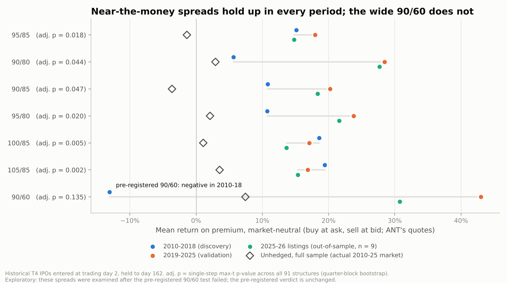

# Can the ANT put-spread edge be proven, and how much should go on it?

The test was **pre-registered** in [PREREG_EDGE_TEST.md](PREREG_EDGE_TEST.md) (commit `4360faf`, pushed 2026-11-23 17:39 UTC, before any test code existed). It was then run by [`src/edge_test.py`](src/edge_test.py). Results: `results/edge_*.csv` and `figs/fig5_edge_by_period.png`.

## Verdict

**Edge NOT statistically established.** The pre-registered rule, applied verbatim, fails on sign consistency: the 90/60 lost money in 2010–2018.

**Pre-registered size: at most 1% of capital at risk, discretionary.** Exploratory work afterwards found nothing that justifies more with liquid strikes.

The edge is *unproven*, not *disproven*. The best estimate is positive in every version tested.

## 1. Pre-registered test

Setup: primary structure 90/60, market-neutral, T4 IPOs entered at trading day 2 and held to day 162, priced at ANT's quotes. n = 61 events in 31 listing quarters.

| Test | Result | Threshold | |
|---|---|---|---|
| Mean return on premium | **+24.6%** (median +57%; total loss in 20% of events) | | |
| T1: quarter-block bootstrap, one-sided | p = **0.038** | < 0.05 | ✅ |
| T2: cluster-robust t (31 clusters) | t = 1.75, p = **0.046** | < 0.05 | ✅ |
| T3: validation, 2019–2025 (n = 41) | **+43.0%**, p < 0.001 | > 0, p < 0.10 | ✅ |
| T3: discovery, 2010–2018 (n = 20) | **−13.1%** | > 0 | ❌ |
| T4: Hansen SPA_c over 91 structures | p = **0.0018** | < 0.05 | ✅ |
| **Decision** | | | **NOT ESTABLISHED** |

Reported, not gating:
- **Confidence intervals.** Naive iid t gives p = 0.021, which ignores clustering. The 90% percentile CI is [−8.6%, +47.4%], but the basic bootstrap CI is [+1.8%, +57.8%]. Significance flips with the CI method, which is a sign of a borderline result.
- **Effective sample size** n_eff = 43, not 61. IPO fades cluster by listing quarter.
- **Data-snooping on the 90/60 itself.** Its max-t adjusted p is **0.135**, so it is *not* significant once you account for picking it from 91 structures. White's Reality Check gives p = 0.27.
- **Deflated Sharpe Ratio.** The per-trade Sharpe is 0.267. The expected best Sharpe of 91 no-skill trials is 0.290, giving a **DSR of 0.43**. After deflating for the search, there is no evidence the 90/60 beats luck.
- **Unhedged, as actually traded:** +7.4% (p = 0.31).
- **T3+T4 pool:** +17.5% (p = 0.040–0.053).
- **Matured 2025–26 listings,** the true out-of-sample set: +30.7% (n = 9, p = 0.18).
- **Power.** About 124 events would give 80% power, against 61 available. That is roughly **16 more years** of mega-IPOs.

The 2010–18 failure comes from event-level results. Alibaba (−43%), Facebook (−60%), JD (−49%), Kinder Morgan (−69%) and Hilton (−80%) faded *less* than the $90→$60 band needs. Four events lost the full premium (PDD, SYF, PAGP, CFG), and Antero lost 95%. The 90/60 pays on the **size** of the fade, which was regime-dependent: the 2021 bubble collapse dominates 2019+. The **direction** of the fade, about 75–80% of names, held in both eras.

## 2. Exploratory: what holds up

None of this section was pre-registered. It does not change the verdict.

**Near-the-money spreads, perfect market hedge.** These spreads bet on direction (e.g. 95/85, 100/85, 105/85). They are positive in 2010–18, in 2019–25 and in the 2025–26 out-of-sample set (7 of 9 wins). Their max-t adjusted p-values range from 0.002 to 0.047. The 100/85 and 105/85 would have passed every pre-registered criterion. Source: `results/edge_exploratory_near_money.csv`.

**But the edge is relative to the market, and the hedge matters:**

| Structure | Perfect hedge | **Weekly QQQ delta hedge** (implementable) | p (boot / cluster) | 2010–18 | Unhedged |
|---|---|---|---|---|---|
| 95/85 | +17.0% | +8.1% | 0.14 / 0.19 | −7.9% | −1.4% |
| 90/80 | +21.0% | +14.3% | 0.09 / 0.12 | −13.9% | +2.9% |
| 90/85 | +17.1% | +6.3% | 0.22 / 0.27 | −17.1% | −3.6% |
| 100/85 | +17.6% | +10.2% | 0.06 / 0.11 | +1.0% | +1.1% |
| **105/85** | +17.7% | **+12.6%** | **0.013 / 0.046** | **+8.2%** | +3.6% |
| 90/60 | +24.6% | +21.8% | 0.08 / 0.07 | −19.8% | +7.4% |

The weekly hedge rebuilds each historical IPO's real daily path from day 2 to day 162. Each week it re-sizes long QQQ to β × |net Δ|, with β = 1.05, Black–Scholes deltas at ANT's strike IVs, and financing at r. Source: `results/edge_delta_hedged.csv`.

- **Unhedged, the edge was ~zero in 2010–25.** The bull market lifted these stocks about as much as they faded vs QQQ.
- **A real hedge captures about half** of the idealized edge. Every liquid structure then loses significance and is negative in 2010–18.
- **The only exception is the 105/85.** It is significant, positive in both eras, and its one-sided 90% lower bound is +1.3%. But its $105 leg traded **zero contracts**, with a $1.90-wide quote. It is post hoc *and* possibly untradeable at the quoted ask.

## 3. Sizing by confidence

The pre-registered rule is computed on the primary 90/60. Source: `results/edge_test_sizing.csv`.

| Method | f (premium at risk, % of capital) | What it assumes |
|---|---|---|
| Plug-in Kelly f* = argmax E[ln(1 + fR)] | 29% | The estimated edge is exactly right |
| Quarter-Kelly | 7.25% | The usual haircut |
| Kelly at the 90% lower confidence bound (−1.4%) | **0%** | The edge could be zero |
| Bayesian Kelly, skeptical prior μ ~ N(0, 5%²) | 4.5% | Posterior mean +2.7%, P(edge > 0) = 72% |
| Bayesian Kelly, prior N(0, 10%²) | 12.25% | Posterior mean +8.2%, P(edge > 0) = 84% |
| Drawdown limit: P(max DD > 25%) ≤ 5% | **2.0%** | IPOs cluster, so many correlated positions are open at once |
| **Pre-registered recommendation: min(f_B(10%), 1%)** | **1%** | **The edge is not established** |

**Why the drawdown limit binds.** The backtest trades every T4 IPO from 2010–2025 at day 2 (market-neutral, 5,000 block-bootstrapped timelines). In the 2020–21 IPO wave, 15 or more positions overlapped. At 2% per trade, peak premium at risk reached 30% of equity.

| f per trade | Growth per year (history) | Max drawdown (history) | P(max DD > 25%) | Notes |
|---|---|---|---|---|
| 1% | +0.9% | −5.8% | 0% | |
| 2% | +1.7% | −11.5% | 2% | |
| 5% | +3.5% | −27% | 53% | |
| 29% (full Kelly) | ruin | | | |
| 2%, unhedged | +0.3% | −23.7% | 29% | |

**With the implementable weekly hedge,** the drawdown-limited size is 2–3% for the liquid spreads and 5% for the 105/85. Posterior P(edge > 0) under the 10% prior is 67–80% for the liquid spreads and 92% for the 105/85. Proving the liquid structures would take **167 to more than 900 events**, or 28 to 230 more years at today's pace. Source: `results/edge_delta_hedged_sizing.csv`.

## 4. Recommendation

1. **Risk at most 1% of capital in total** on this idea. That is the pre-registered rule, and the exploratory analysis doesn't overturn it.
   - The expected value is probably positive: the posterior P(edge > 0) is about 70–90%, depending on structure and hedge.
   - It is not provable today, and hedged or not, the historical downside cases are real.
2. **Number of contracts:** n = floor(0.01 × capital ÷ (100 × debit)).
   - On a $100k account, a 1% budget is $1,000. A 90/60 costs $1,360, so a single spread would be 1.4%.
   - A 90/80 costs $570, so one fits.
   - Size *down* to the budget rather than rounding up.
3. **Pick the structure for how you will hold it:**
   - **Unhedged:** you are also betting QQQ won't rally. The 90/60 had the best unhedged history (+7.4%, not significant).
   - **With a QQQ hedge** (≈ 3.2 QQQ shares per 90/60 spread, or ≈ 1.1 per 95/85 or 90/80, re-sized weekly): you isolate the fade the study measures. The 105/85 is statistically strongest, *if* you can get filled at or below the $13.70 debit, which is doubtful given its untraded $105 leg.
4. **Earning a larger size has to come from new data.**
   - ANT itself is one new observation. Each future mega-IPO is another, so treat this as a running experiment.
   - The follow-up hypothesis is pre-registered below, so the next test can't be bent either.

## 5. Pre-registered follow-up (for future data)

These rules are fixed now, before any of the data exists.

- **Universe:** T4 IPOs listing after 2026-11-23, ANT included.
- **Trade:** at the day-2 close, buy the near-the-money put spread with long strike ≈ 1.20 × spot and short ≈ 0.97 × spot (the 105/85 analog). Use the stock's own live quotes, with a weekly QQQ delta hedge. Hold to day 162.
- **Test:** a one-sided quarter-block bootstrap on the mean return on premium, first evaluated at n ≥ 30 events.
- **Edge established iff:** p < 0.05, and mean > 0 within both the first and second halves of the new sample.
- **Sizing until then:** ≤ 1% per trade.

## 6. Limitations

- **Pricing assumption.** Historical events are priced at ANT's 2026-11-23 quotes; most comparables had no listed options at day 2. The test asks whether *ANT's* options are cheap relative to how comparables traded. It is not a record of trades that were actually available.
- **Hedge model.** The hedge uses Black–Scholes deltas with sticky-strike IV and β = 1.05 for every name. Real betas of new IPOs are noisy.
- **Snooping.** The 90/60 was chosen on the same data. SPA, max-t and DSR are the corrections, and the 90/60 fails the targeted ones.
- **Dependence.** Fades cluster by listing quarter, so n_eff is about 43, not 61. The block bootstrap respects this; naive t-tests overstate significance.
- **Bootstrap method.** The full-sample result is borderline: it passes with the centred bootstrap and the basic CI, and fails with the percentile CI.
- **Not investment advice.** This is a statistical evaluation of a historical pattern.
