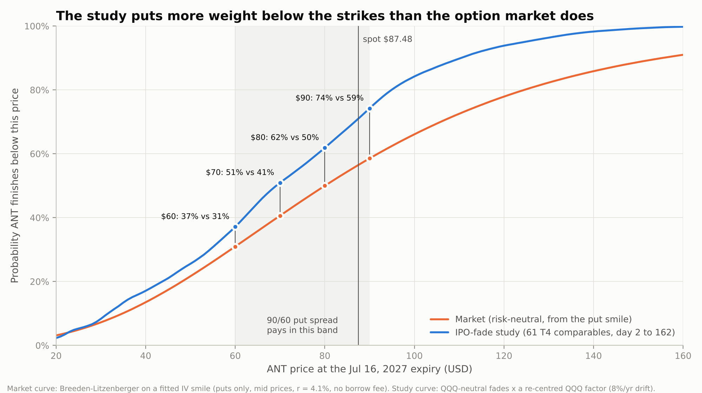

# ANT Jul-16-2027 puts, priced against the IPO-fade study

**Quote:** the put chain from a broker screenshot, taken on 2026-11-23 at about 10:14 with ANT at **$87.48** (ANT trading day 2). Every row was checked: the broker's "Breakeven" column equals strike minus mid.
**Inputs:** expiry 2027-07-16, which is 235 calendar days (T = 0.644y) and 160 trading days away (ANT day 2 → day 162). r = 4.1% (13-week T-bill). Data: [`data/ant_put_chain_2027-07-16_snapshot.csv`](data/ant_put_chain_2027-07-16_snapshot.csv).
**Code:** [`src/options_quant.py`](src/options_quant.py). Every number below is in `results/options_*.csv`.

> This is a quantitative read of the study against the option market, not personalized investment advice. The study's edge is **not statistically established**: the confidence intervals below span zero, as the parent study's pre-registered test did.

## 1. What changed since listing

| | |
|---|---|
| Day 0 (Nov 19) | open $111.50 · high **$115.10** · close **$97.17** (+17% vs the $83 offer; **−12.9% open → close**, the 2nd percentile of all T4 debuts) |
| Day 1 (Nov 20) | close $88.91; QQQ −5.7% on the day and VIX closed at 35.9 |
| Day 2 (Nov 23) | ≈ $87.5: **−11% QQQ-neutral vs the day-0 close** (13th percentile of T4) and **−25% from the day-0 high** (5th percentile) |

**Does an early fade use up the fade?** No, according to the data.
- Regressing the forward QQQ-neutral return (day 2 → 162) on the day-0 → 2 move gives a slope of +0.23, with t = 0.53 (T4) and quarter-clustered SEs. That means no mean reversion.
- Early faders (worse than −5% by day 2) went on to fade a median −22% (n = 20), against −24% for the rest.
- The one striking subgroup is IPOs that closed more than 5% below their day-0 open, as ANT did. They faded a median **−50%** (T4, n = 13). This cut was not pre-registered, so it is reported only as a sensitivity.

## 2. Two distributions for ANT on Jul 16, 2027

**Market (risk-neutral, Q).**
- Implied volatility is ≈ 69% at the money, with a put skew up to 77% at the $45 strike.
- The fitted smile is σ(k) = 0.690 − 0.081k + 0.056k², with k = ln(K/F).
- The risk-neutral CDF comes from Breeden–Litzenberger on that smile:

$$Q(S_T<K)=e^{rT}\frac{\partial P}{\partial K}=N(-d_2)+e^{rT}\,\mathcal{V}(K)\,\sigma'(K)$$

**Study (physical, P).** Each of the 61 historical T4 IPOs contributes its own QQQ-neutral move over the same window, days 2 → 162. That move is combined with every rolling 160-session QQQ return from 2010–2026, re-centred to an 8%/yr drift so the 2010s bull market does not leak in:

$$S_T^{(i,j)}=S_0\,(1+\mathrm{rel}_i)\,M_j,\qquad \mathrm{rel}_i=\frac{1+s_i}{1+q_i}-1,\qquad \mathbb{E}[M]=e^{\mu T}$$

The comparables' realized volatility over this window had a median of **62%** (IQR 39–92%), with beta to QQQ ≈ 1.05. The market's 69% IV is therefore about fair-to-slightly-rich on volatility. Any edge comes from **drift**: risk-neutral pricing assumes a drift of r, while the study's median forward move is **−24% vs QQQ**.

| Percentile | Study (base) | Study, QQQ flat | Study, raw historical paths | Study, "weak day-0 close" (T3+T4, n = 33) | **Market (Q)** |
|---|---|---|---|---|---|
| 10 | $32 | $31 | $30 | $29 | $35 |
| 25 | $49 | $50 | $55 | $38 | $54 |
| **50** | **$69** | $66 | $73 | $57 | **$80** |
| 75 | $91 | $84 | $96 | $83 | $114 |
| 90 | $110 | $103 | $120 | $122 | $155 |

The two curves nearly agree in the far-left tail. The market prices a much fatter **right** tail than the comparables ever delivered. The gap is largest just below spot: P(ANT < $90) is 74% for the study against 59% for the market.

## 3. Pricing every structure

Each structure is bought at the ask and any short leg sold at the bid. All 13 single puts and 78 put spreads are in `results/options_single_puts.csv` and `results/options_put_spreads.csv`.

$$\mathrm{EV}=e^{-rT}\,\mathbb{E}_P\big[(K_1-S_T)^+-(K_2-S_T)^+\big]-D,\qquad f^*=\arg\max_f\ \mathbb{E}_P\big[\ln(1+fR)\big],\ R=\tfrac{\text{payoff}}{D}-1$$

Estimation risk is handled the same way as in the parent study: a moving-block bootstrap over listing quarters.

| Structure | Debit | Max gain | Breakeven | EV ($/sh) | **EV %** | 90% CI | P(win) | P(max loss) | Kelly f* | Bootstrap P25 f* | EV % if ANT "catches up" to the path |
|---|---|---|---|---|---|---|---|---|---|---|---|
| Long 90 put | $19.60 | uncapped (to $90) | $70.40 | +3.74 | +19.1% | [−27%, +52%] | 51% | 26% | 19.5% | 1.9% | **−0.2%** |
| **90/60 put spread** | **$13.60** | **$16.40** | **$76.40** | +2.82 | **+20.7%** | [−11%, +44%] | **57%** | 26% | 26.0% | 9.4% | +1.9% |
| 90/70 put spread | $10.10 | $9.90 | $79.90 | +2.00 | +19.8% | [−8%, +38%] | 61% | 26% | 28.0% | **12.9%** | +2.7% |
| 85/60 put spread | $10.70 | $14.30 | $74.30 | +2.26 | +21.1% | [−14%, +47%] | 55% | 32% | 22.5% | 7.4% | +1.1% |

Notes on the table:
- **"Catch-up" model:** ANT reverts to the T4 path anchored on its $97.17 day-0 close, giving a median of $77. The regression in §1 does not support this model, but it is the conservative case. Only the spreads stay positive under both models.
- **Excluded strikes:** spreads with the $100–$105 long leg rank highest on Kelly growth. They are excluded because those strikes traded 0–3 contracts with $1.10–$1.90 bid/ask spreads.
- **Execution:** working the 90/60 at the mid ($13.30) instead of the natural price ($13.60) adds about 2 percentage points of EV.

**Greeks per contract**, from Black–Scholes at each strike's IV:

| Structure | Δ (shares) | $Δ | Vega ($/vol pt) | Θ ($/day) |
|---|---|---|---|---|
| Long 90 put | −39 | −$3,434 | $27.0 | −$3.4 |
| 90/60 spread | −23 | −$2,001 | $9.6 | −$0.9 |
| 90/70 spread | −16 | −$1,377 | $5.4 | −$0.4 |

## 4. Stress tests

P&L is shown as % of the debit, repriced on the fitted smile. Full grid: `results/options_stress_grid.csv`.

| ANT on May 17, 2027 (3.0B-share unlock) | $60 | $70 | $80 | $87.48 (flat) | $100 | $110 |
|---|---|---|---|---|---|---|
| 90/60 spread, IV unchanged | +71% | +34% | −4% | −28% | −58% | −74% |
| 90/60 spread, IV −15 pts | +78% | +35% | −10% | −39% | −71% | −86% |
| Long 90 put, IV unchanged | +54% | +11% | −24% | −45% | −69% | −81% |
| Long 90 put, IV −15 pts | +51% | +5% | −34% | −56% | −80% | −90% |

The spread beats the outright put everywhere except a crash: below about $41 on May 17, or below $54 at expiry. It also carries about a third of the vega, which matters with VIX at 28–36: if volatility normalizes, a long put loses even when ANT drifts lower.

## 5. Risk levels

**Size.** The number of contracts is n = ⌊ f · W / (100 · D) ⌋, where W is capital and D is the debit.

| Level | f, premium at risk as % of capital | Rationale |
|---|---|---|
| 1, conservative | **1–2%** | The bootstrap P10 Kelly is **0**: in 10–22% of resamples the optimal bet is nothing |
| 2, moderate | **2.5–3%** | About 1/10 of Kelly |
| 3, hard ceiling | **6.5%** | Quarter-Kelly for the 90/60. Never full Kelly (26%): the CI spans zero and n = 61 |

**Thesis stops.** These come from the study's T4 path percentiles, anchored on the $97.17 day-0 close and scaled by QQQ:

$$L_t = 97.17 \times \mathrm{pctl}_t \times \frac{\mathrm{QQQ}_t}{645.04}$$

| Checkpoint | Date | Study median | **Cut half above (P75)** | **Exit above (P90)** |
|---|---|---|---|---|
| day 20 | Dec 18, 2026 | $96.66 | **$105.17** | $114.39 |
| day 40 | Jan 20, 2027 | $92.79 | **$102.87** | $122.89 |
| day 60 | Feb 18, 2027 | $86.71 | **$106.01** | $119.88 |
| day 90 | Apr 2, 2027 | $81.70 | **$99.63** | $127.31 |
| day 121 | May 17, 2027 | $74.22 | **$96.99** | $125.15 |

**Backstop.** As a hard premium stop, close the 90/60 at −50% of its debit. With IV unchanged, that happens at ANT ≈ $120 on Dec 18, ≈ $108 on Mar 8, ≈ $96 on May 17, and ≈ $90 on Jun 15.

**Profit-taking.** Close at 75% of the spread's max value: $22.50 on the 90/60, a +65% gain. That level is reached at ANT ≈ $54 on Dec 18, ≈ $57 on Mar 8, ≈ $62 on May 17, and ≈ $64 on Jun 15. Alternatively, scale out half after the ~1.7B FY2026-results unlock (est. early March) and the rest after May 17.

**Time stop.** Close by about Jun 15, 2027. After the May 17 unlock the T4 median path is flat ($74.22 at day 121 against $74.29 at day 162), while theta accelerates.

**Entry timing.** Theta drag until the Dec 18 index-inclusion close is small: −1.6% of debit for the 90/60 and −4.3% for the 90 put. Index buying can still squeeze the stock first; SPCX gained +4.7% into its inclusion, then fell −28.6% over the next 20 sessions. Splitting the entry hedges this: half now, half at or after the Dec 18 close, which is the parent's pre-registered +20 entry.

**Isolating the study's edge.** The study measures underperformance against QQQ; a put also bets on the market. To trade only the fade, buy QQQ worth

$$h=\beta\,|\Delta_{\text{net}}|\cdot 100\cdot S_{\text{ANT}}/S_{\text{QQQ}}$$

That is ≈ **3.2 QQQ shares per 90/60 spread** (β = 1.05). Re-hedge as Δ moves.

**What not to do:**
- **Don't short the stock.** The float is ~7%, index buying is projected, the borrow fee is unknown and likely high, and the loss is uncapped. ARM ran +122% against a hedged short. The put structure caps exactly that tail.
- **Don't use the Dec-2026 or Jan-2027 expiries.** The fade is back-loaded, around days 50–120.
- **Avoid the Apr-2027 expiry.** It ends before the 3.0B-share unlock.

## 6. Limitations

- **The edge is unproven.** Every 90% CI includes zero, and the parent's pre-registered test fails. The SPCX analog went against the +20 entry (−13.7% so far).
- **Small, out-of-support sample.** There are 61 comparables, none of ANT's size with an outcome at this horizon. The early-fade conditioning and the weak-close subgroup are exploratory.
- **Puts only.** Only puts were quoted, so put–call parity cannot back out the market's implied borrow fee. If ANT is hard to borrow, the IVs above are overstated. The EVs use actual quotes, so they are unaffected. Sending the call side of the chain would allow the borrow fee to be estimated.
- **Model choices.** These include European Black–Scholes Greeks on American options, a quadratic smile fit, an independent market factor with beta = 1, and quotes from one moment of a fast-moving tape.
