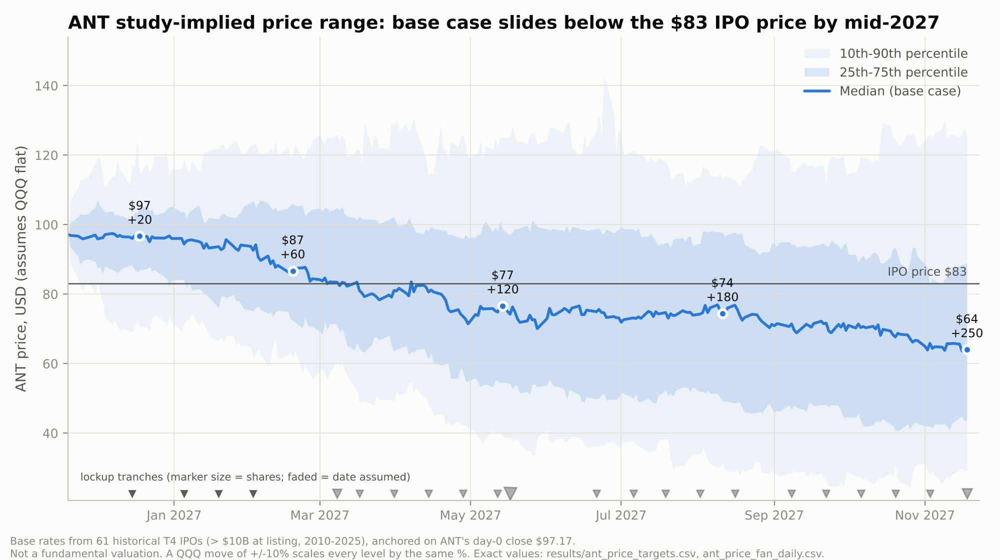
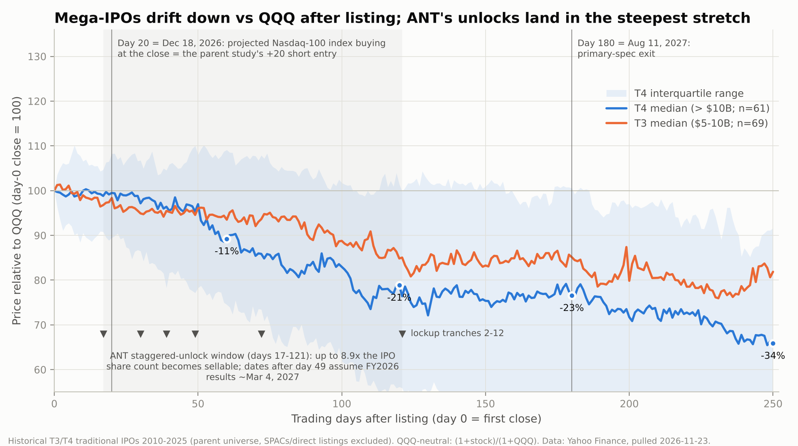
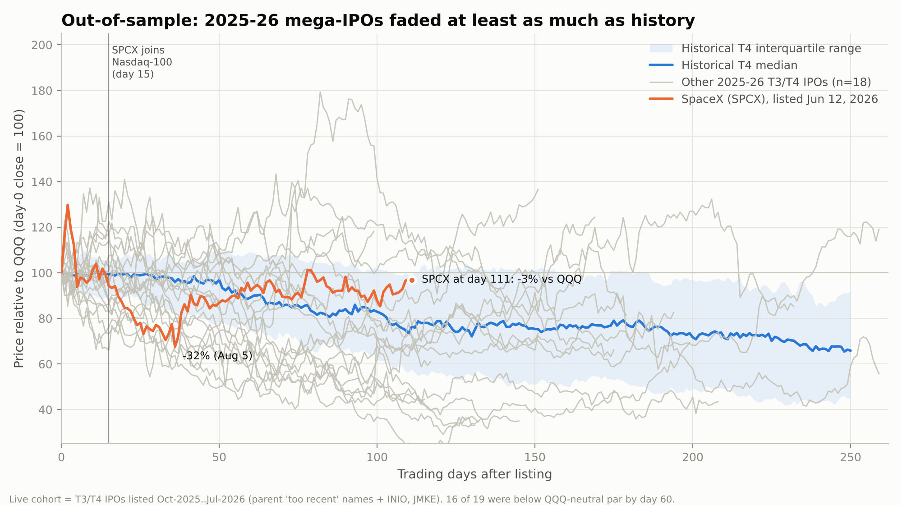

# Does the IPO fade apply to Anthropic (ANT)? Study and price targets

**Run date:** 2026-11-19, ANT's first trading day. Analysis ran before the open, at about 11:20 ET; Yahoo showed only a placeholder bar.
**Prices:** Yahoo Finance, complete sessions through the 2026-11-18 close.
**Deal terms:** Anthropic's pricing FWP and filing list on EDGAR (CIK 0002130357), plus press readings of the S-1/A. Every field is cited in [`data/ant_deal_terms.csv`](data/ant_deal_terms.csv).
**Parent study:** this repo's IPO-fade generalization. Brief: `../ipo_fade_generalization_brief.md`. Results: `../results/`.

> **Update, 2026-11-23.** ANT's day-1 prints are in: open $111.50, high $115.10, close **$97.17** (+17%). Day 2 traded at ≈ $87.5.
> `results/` and the figures have been re-run, anchored on these prints. The T4 median for +180 is now $74.40 from the close, or $81.70 from the high. The pre-open tables below are kept as the original record. The options follow-up is in [OPTIONS_QUANT.md](OPTIONS_QUANT.md).

> These are **base-rate** price targets: the empirical spread of what comparable IPOs did, mapped onto ANT's price and trading calendar. They are not a fundamental valuation, a forecast of the market, or investment advice.

---

## TL;DR

1. **The fade applies to ANT as a base rate.** ANT is a traditional, firm-commitment, underwritten Nasdaq IPO worth about $1.1T on basic shares (about $1.5T fully diluted) at $83. That puts it squarely in the study's T4 population (> $10B at listing).
   - Of 61 historical T4 IPOs, 74% underperformed QQQ by trading day +180, measured from their day-1 close. The median was −23% QQQ-neutral.
   - The median give-back from the day-1 high was **29.2%**, the same as the legacy Study-1 headline.
2. **Nothing in the data exempts a $1T IPO.**
   - Fade depth does not change with size inside T4. The log market-cap slope is +0.02 (t = 0.25).
   - 7 of the 8 IPOs of $50B or more faded vs QQQ by +180. ARM is the lone, violent exception.
   - The **2025–26 mega-IPO cohort faded at least as much as history**: 16 of 19 had faded by day 60 and 5 of 6 by day 180.
3. **ANT has the "special structure" the parent study pointed to.** The parent concluded the fade is real but "only tradeable when listing structure is special (SPCX-style float/lockup calendars)." ANT's structure:
   - About 7% float.
   - A **23-date staggered lockup**: up to 1.66× the IPO share count is sellable by Feb 2, 2027, and up to **8.9×** by May 17, 2027.
   - Projected **Nasdaq-100 fast entry, with index buying at the Dec 18 close**. That close is also day +20, the parent's pre-registered short entry.
   - A listing in the high pre-listing-VIX tercile, where historical fades were deepest.
4. **The study does not certify a systematic edge.**
   - The parent's pre-registered test **fails**: its validation-period confidence interval (CI) at 10% borrow spans zero. It still fails in this rebuild, and it fails for T4 alone, with a validation CI at 10% borrow of [−3.7%, +30.3%].
   - The right tail is real. A hedged short on ARM lost 122%.
   - SPCX is the closest analog. It fell 49% from peak to trough by day 36, but a short opened at the parent's +20 entry is **−13.7%** today because SPCX recovered while QQQ fell.
5. **Price targets.** These assume QQQ stays flat, use the T4 base rates (n = 61), and are anchored on the $83 offer because ANT had not opened when this ran.

| Horizon | Date | Bear (P25) | **Base (median)** | Bull (P75) | P(below $83) |
|---|---|---|---|---|---|
| +20 | Dec 18, 2026 (index-inclusion close) | $84 | **$92** | $115 | 25% |
| +60 | Feb 18, 2027 | $74 | **$86** | $105 | 41% |
| +120 | May 14, 2027 (next to the 3.0B-share unlock) | $53 | **$73** | $98 | 57% |
| +180 | Aug 11, 2027 (primary-spec exit) | $50 | **$73** | $100 | 59% |
| +250 | Nov 18, 2027 (~12 months, 365-day unlock) | $47 | **$65** | $87 | 66% |

   Once ANT has a day-1 close C and a day-1 high H, the median base cases are:
   - **+180 ≈ 0.77 × C ≈ 0.71 × H.**
   - **+250 ≈ 0.66 × C ≈ 0.63 × H.**

   [§5.2](#52-scenario-grid--if-ant-closes-day-1-at-) tabulates every day-1 outcome. Re-running `python Anthropic/src/run_all.py` after the close re-anchors every target on the actual prints.



---

## 1. What "this study" is

The parent work has two layers:

- **Legacy Study 1** (SpaceX_Thesis): traditional underwritten IPOs over $10B gave back a median of −29.2% vs QQQ within 180 trading days of the day-1 high (n = 63, t = −6.51, 79% fade rate). The parent's `results/regression_test.csv` reproduces this exactly.
- **This repo's generalization:** a $300M floor and tiers T1–T4.
  - **The one pre-registered test:** universe T3+T4 (≥ $5B). Short at the close of trading day +20, cover at the close of +180, and hedge with QQQ, equal dollar.
  - **The decision rule:** the validation-period (2019+) hedged mean must be positive, with a quarter-clustered block-bootstrap 95% CI excluding zero, at 10% annual borrow.
  - **Verdict: FAIL.** The fade is real, with medians and hit rates strongly positive. But IPO fades cluster by listing quarter, so the CI spans zero. The parent's fallback conclusion: *"no systematic edge after costs; the fade is real but only tradeable when listing structure is special (SPCX-style float/lockup calendars)."*

Applying the study to Anthropic asks three things:

- **(a)** Is ANT in the population?
- **(b)** What does the base rate imply for ANT's price path?
- **(c)** Is ANT one of the "special structures" where the fade is most likely to show up?

## 2. Data and methods

The cohort was fixed before computing anything about ANT. Code is in `src/fetch_cohort.py`; the audit is in `data/cohort_universe.csv`.

| Role | Definition | n usable |
|---|---|---|
| Historical (base rates) | The parent's T3+T4 headline universe: traditional IPOs ≥ $5B, 2010–2025; SPACs, direct listings, spinoffs and uplistings excluded | **130** (T4 = 61, T3 = 69) |
| Live (out-of-sample) | T3/T4 names the parent marked "too recent" (listed Oct-2025 to Jul-2026), plus INIO and JMKE, which its seed calendar missed | **19** |
| Subject | ANT, listed 2026-11-19 | n/a |

**Survivorship and fetch log** (`data/price_fetch_log.csv`):
- 25 of the 155 historical names are unusable:
  - **22 are absent from Yahoo**: the 20 the parent also lost (TWTR, XM, HCP, FDC, ATUS, CFLT, ZNGA, …), plus EQGP and GOCO, which have disappeared from Yahoo since July.
  - **KVUE and OLPX** now have truncated Yahoo histories, with the first bar in 2026. They are logged as `late_start_gap`.
  - **SDC** is now a recycled ticker belonging to a new 2026 listing. It is rejected.
- The parent's regression-tested day-0 anchors are treated as authoritative. Two Yahoo defects would otherwise mis-anchor events:
  - Venture Global's first four real sessions show **zero volume**.
  - PECO has junk pre-listing prints: $7.29 on 13k shares before its $28 IPO.

  `common.placeholder_mask` documents both. The same guard rejects ANT's pre-open placeholder bar (O = 0, H = L = C = $83, V = 0).
- Tier corrections for the live cohort only, from StockTitan's list of 2026 IPOs, each logged with a reason:
  - BSP moves from T4 to T3 ($9.42B).
  - DSC's $16B estimate came from a low-confidence share count and could not be verified, so it is excluded.
  - INIO is added (T4, $20.25B).
  - JMKE is added (T3, $7.31B).
  - SKHY is excluded: it cross-listed an already-public company, which works like an uplisting.

**Consistency gate** (parent ground rule #1, in spirit): the rebuilt panel was compared with the parent's `results/event_panel.csv`.
- **148 overlapping events and 3,310 grid cells. Max |diff| = 1.6e-06.**
- Since the parent's July freeze, 230 cells have matured.
- `results/consistency_check_vs_parent.csv` has the detail.

**Metrics.** Day 0 is the listing day. Returns are close to close on AdjClose, and QQQ is aligned to each stock's own dates.
- Hedged fade: `x_h = QQQ_ret − stock_ret`. This is the parent's dollar-neutral metric; positive means the stock faded.
- **Price targets use the QQQ-neutral ratio** `rel_h = (1+stock)/(1+QQQ) − 1`, which never implies a negative price. A target equals the anchor × (1 + rel). If QQQ moves by m%, every target scales by the same m%.
- The day-1 intraday high is used only as the legacy measurement reference, never as an entry price.

## 3. Is ANT in the study's population?

| Criterion | Study rule | ANT | |
|---|---|---|---|
| Listing type | Traditional underwritten IPO; no SPAC, direct listing, spinoff or uplisting | Firm-commitment IPO. Goldman Sachs and Morgan Stanley lead, with 20 other banks. 424B4 filed 2026-11-19 | ✅ |
| Size tier | T4 > $10B at listing (offer × post-issue shares) | ≈ 13.24B basic shares × $83 ≈ **$1.10T**; ≈ $1.5T fully diluted | ✅ T4 |
| Venue and era | NYSE or Nasdaq, 2010+ | Nasdaq Global Select, 2026 | ✅ |
| Executable entry | Closes only | ANT's first close is today | ✅ |
| In-sample support | Historical T4 tops out at BABA's $170B with a +180 outcome; SPCX is $1.77T but has only reached day 110 | ~6.5× BABA | ⚠️ extrapolation (see §4.3) |

## 4. Results

### 4.1 The parent's verdict reproduces, and still fails

These are T3+T4 primary-spec figures (short at the +20 close, cover at +180). Source: `results/primary_spec_reproduction.csv`.

| Source | Split | n | Mean, gross | Mean @10% borrow | 95% CI @10% (quarter-clustered) | Hit @10% |
|---|---|---|---|---|---|---|
| Parent panel (exact replay) | validation | 98 | +20.9% | +14.6% | [−9.7%, +23.6%] | 71% |
| This rebuild | validation | 95 | +20.5% | +14.2% | [−10.6%, +23.4%] | 71% |
| T4 only (exploratory) | validation | 41 | +26.7% | +20.4% | [−3.7%, +30.3%] | 80% |
| T4 only (exploratory) | full | 61 | +22.7% | +16.4% | [+0.3%, +26.1%] | 74% |
| Matured since the parent's verdict | out-of-sample | 6 | +34.7% | +28.3% | n/a (n = 6) | 83% |

**Decision rule, applied verbatim to T3+T4 validation: FAIL, unchanged.** The T4-only full-period CI barely excludes zero, but it is an exploratory subgroup and is **not** promoted (parent anti-goal #1). The parent's bootstrap CI was [−10.0%, +23.5%]; the small difference here comes only from the Monte Carlo random stream.

### 4.2 Base rates for ANT's tier

These are QQQ-neutral returns for historical T4 (n = 61). Source: `results/horizon_stats.csv`.

| Horizon | Median from day-1 close | Share that faded | Median give-back from day-1 high | Price ÷ offer (median) | Share below offer |
|---|---|---|---|---|---|
| +20 | −0.5% | 52% | −5.3% | 1.11 | 25% |
| +60 | −10.8% | 64% | −14.1% | 1.03 | 41% |
| +120 | −21.1% | 72% | −25.7% | 0.88 | 57% |
| +180 | **−23.4%** | **74%** | **−29.0%** (additive: −29.2%) | 0.88 | 59% |
| +250 | −34.1% | 84% | −37.0% | 0.78 | 66% |

The fade is **back-loaded**: the median T4 is flat against QQQ through day +20 and declines mostly between days 50 and 120. That stretch is exactly where ANT's dense unlock schedule falls (Figure 1).



### 4.3 Does a ~$1T IPO behave like a $20B IPO?

OLS with SEs clustered by listing quarter. Source: `results/size_regression.csv`.

| Sample | y | log(mcap) coef | t | p | n (clusters) |
|---|---|---|---|---|---|
| T4 | fade day 0 → +180 | +0.018 | 0.25 | 0.80 | 61 (31) |
| T4 | primary spec +20 → +180 | −0.037 | −0.44 | 0.66 | 61 (31) |
| T3+T4 | fade day 0 → +180 | +0.058 | 1.15 | 0.25 | 130 (43) |
| T3+T4, with pop, VIX and realized-vol controls | fade day 0 → +180 | +0.034 | 0.74 | 0.46 | 130 (43) |

There is no detectable size gradient. Assuming ANT behaves like a $10–170B IPO is still an **untestable extrapolation**, because only SPCX is comparable in size and it has not reached day +180.

**Every US IPO of $50B or more since 2010**, from `results/mega_ipo_roster.csv`. Fade columns use the parent's additive hedged metric, QQQ return minus stock return from the day-1 close; positive means the stock faded.

| IPO | Year | Mcap at offer | Day-1 pop | Fade by +60 | Fade by +180 | Primary spec (+20 → +180) |
|---|---|---|---|---|---|---|
| Alibaba (BABA) | 2014 | $170B | +38% | −10% | +15% | +21% |
| Facebook (META) | 2012 | $92B | +1% | +57% | +37% | +48% |
| Uber (UBER) | 2019 | $76B | −8% | +5% | +31% | +38% |
| **ARM** | 2023 | $72B | +25% | −2% | **−79%** | **−122%** |
| Rivian (RIVN) | 2021 | $68B | +29% | +33% | +47% | +52% |
| Coupang (CPNG) | 2021 | $62B | +41% | +28% | +71% | +87% |
| Venture Global (VG) | 2025 | $60B | −4% | +48% | +76% | +76% |
| GM | 2010 | $50B | +4% | +6% | +25% | +29% |
| SpaceX (SPCX) | 2026 | $1,767B | +19% | +8% | n/a (day 110) | n/a |

### 4.4 Conditioning, and ANT's regime

Historical T3+T4, n of 43–44 per tercile. Source: `results/conditioning.csv`.

- **Day-1 pop does not predict the later fade.** Median fade by +180 is 22.0%, 20.2% and 21.5% across the low, mid and high pop terciles. Targets therefore scale about linearly with ANT's day-1 close.
- **Pre-listing VIX does.**
  - Low tercile (VIX ≤ 16.1): median fade +11.6%, hit rate 64%.
  - Mid tercile: +28.3%, 74%.
  - High tercile (VIX > 19.45): +26.2%, 79%.
  - **ANT's 21-day pre-listing VIX averaged 20.2, which is the high tercile.** VIX was 24.6 on Nov 18, and QQQ fell 7.9% over the prior month.
  - The T4 × high-VIX subgroup (n = 26) is reported in `results/ant_price_targets.csv` as a sensitivity. It is not the headline.

### 4.5 Out-of-sample: the 2025–26 cohort faded at least as much as history

Source: `results/live_check_2025_26.csv`; see Figure 3.

| Horizon | Live names that faded | Historical hit rate | Live median fade | Historical median | p, live fades **more** (binomial) |
|---|---|---|---|---|---|
| +20 | 13/19 | 55% | +6.7% | +1.3% | 0.16 |
| +60 | **16/19** | 62% | **+24.5%** | +7.8% | **0.03** |
| +90 | 14/18 | 65% | +31.5% | +13.9% | 0.18 |
| +120 | 12/14 | 74% | +31.1% | +20.6% | 0.25 |
| +180 | 5/6 | 72% | +37.8% | +20.9% | 0.47 |

The live events overlap in a single 2026 market regime, so they are not independent. Read the table as "the pattern has not decayed," not as a precise estimate. The most recent AI IPO, **Cerebras (CBRS, May 2026), faded 67% vs QQQ by +120.** The two worst historical T4 outcomes in the AI era were also AI-infrastructure names that ran against the short: ARM (2023) and CoreWeave (CRWV, 2025, −43%). "AI" is not a reliable exemption in either direction, and n is too small to test it.



### 4.6 SPCX: the closest structural analog

SPCX is a mega-cap with about 4% float, staggered lockups, 30% retail allocation, and Nasdaq-100 fast entry on day +15. Source: `results/spcx_case_study.csv`.

| | |
|---|---|
| Offer, then day-1 open, high and close | $135, then $150.00, $176.52 and $160.95 (+19.2%) |
| Peak close | **$211.39 on day 2** (Jun 16) |
| Nasdaq-100 announcement (Jun 26) to inclusion close (Jul 6) | **+4.7%** (QQQ +2.3%) |
| Next 20 sessions after inclusion | **−28.6%** |
| Trough | **$108.27 on day 36** (Aug 5): −48.8% from the peak, −20% below the offer, −32% QQQ-neutral |
| Latest close (Nov 18, day 110) | $143.50: −10.8% from the day-1 close, −2.7% QQQ-neutral |
| Parent primary spec so far (short Jul 14 at $136.08) | **−13.7%** against the short (stock +5.5%, QQQ −8.3%) |

**Lesson for ANT (n = 1, anecdotal).** In the special-structure case the fade arrived **early and fast**: a run-up into index inclusion, then a crash into the first unlocks. It then retraced. A rule keyed to fixed trading days (+20 to +180) caught the bottom of the move and then gave much of it back. This is the parent's exploratory "lockup-anchored vs listing-anchored" question (Battery G), and it remains untested here.

### 4.7 ANT's structure next to SPCX's

| | SPCX (Jun 2026) | ANT (Nov 2026) |
|---|---|---|
| Valuation at offer | $1.77T | ~$1.10T basic / ~$1.5T fully diluted |
| Base deal | $75.0B (555.6M shares) | $81.3B (980M shares; upsized from 825M; priced **above** the $70–78 range) |
| Float at IPO | ~4.2% | **~7.4%** (980M of ~13.24B) |
| Retail allocation | 30% | up to 20% |
| Concurrent placement | n/a | $26B of Class N stock to Google, Microsoft, Nvidia and AMD at $83; **not locked up** |
| Lockup | Fewer than 10 release dates; insiders 366 days; others 180 days, staggered | **23 release dates.** Up to 315M shares on day 1. ~1.3B more on Dec 15, Jan 5, Jan 19 and Feb 2. 1.7B after FY2026 results, then 5 × 474M. **3.0B by May 17, 2027.** About 15.5B in total |
| Nasdaq-100 | Announced day 9; effective day 15 | Projected: rank date day 6 (Nov 30); announcement Dec 11; **index trade at the Dec 18 close (day +20)**; effective Dec 21 |

## 5. Price targets

All targets assume QQQ is flat from the anchor date. Multiply by (1 + QQQ return) for any other market path. Full tables, with P10 and P90, are in `results/ant_price_targets.csv` and `results/ant_price_fan_daily.csv`.

### 5.1 Anchored on the offer (available before the open)

Each comparable contributes $83 × its own (day-1 close ÷ offer) × (1 + rel_h).

| Horizon | Date | T4 median [P25–P75] (n = 61) | T3+T4 median [P25–P75] (n = 130) | T4 × high-VIX median (n = 26) | P(< $83), T4 |
|---|---|---|---|---|---|
| +20 | 2026-12-18 | **$92** [84–115] | $91 [81–116] | $104 | 25% |
| +60 | 2027-02-18 | **$86** [74–105] | $87 [74–111] | $88 | 41% |
| +120 | 2027-05-14 | **$73** [53–98] | $80 [58–99] | $78 | 57% |
| +180 | 2027-08-11 | **$73** [50–100] | $80 [54–105] | $78 | 59% |
| +250 | 2027-11-18 | **$65** [47–87] | $71 [49–102] | $65 | 66% |

### 5.2 Scenario grid: if ANT closes day 1 at …

Historical T4, QQQ-neutral. Each cell shows the median target, the [P25–P75] range, and P(below $83). Source: `results/ant_scenarios_by_day0_close.csv`.

| Day-1 close | +20 (Dec 18) | +60 (Feb 18) | +120 (May 14) | +180 (Aug 11) | +250 (Nov 18, 2027) |
|---|---|---|---|---|---|
| $83 (flat) | $83 [74–90], 52% | $74 [62–91], 64% | $65 [47–84], 72% | $64 [42–83], 74% | $55 [37–76], 84% |
| $90 (+8%) | $90 [81–97], 31% | $80 [67–98], 54% | $71 [51–91], 67% | $69 [46–90], 69% | $59 [40–82], 75% |
| $100 (+20%) | $99 [89–108], 20% | $89 [75–109], 41% | $79 [56–101], 57% | $77 [51–101], 59% | $66 [45–92], 72% |
| $110 (+33%) | $109 [98–119], 13% | $98 [82–120], 28% | $87 [62–112], 46% | $84 [56–111], 49% | $72 [49–101], 66% |
| $125 (+51%) | $124 [112–135], 5% | $112 [93–136], 13% | $99 [70–127], 41% | $96 [63–126], 33% | $82 [56–115], 51% |
| $140 (+69%) | $139 [125–152], 0% | $125 [104–153], 10% | $110 [79–142], 30% | $107 [71–141], 30% | $92 [63–128], 36% |
| $166 (+100%) | $165 [149–180], 0% | $148 [124–181], 7% | $131 [93–168], 18% | $127 [84–167], 25% | $109 [75–152], 30% |

### 5.3 Rules of thumb once day-1 prints exist

Medians for historical T4, QQQ-neutral.

| Horizon | × day-1 close (median [P25–P75]) | × day-1 intraday high |
|---|---|---|
| +20 | 0.995 [0.90–1.08] | 0.947 |
| +60 | 0.892 [0.75–1.09] | 0.859 |
| +120 | 0.789 [0.56–1.01] | 0.743 |
| +180 | **0.766** [0.51–1.01] | **0.710** |
| +250 | 0.659 [0.45–0.92] | 0.630 |

### 5.4 The parent's trade on ANT's calendar

The trade: **short at the Dec 18, 2026 close (+20) and cover at the Aug 11, 2027 close (+180), with a long-QQQ hedge.** Source: `results/ant_primary_trade_view.csv`.

| Cohort | n | Median rel. move (+20 → +180) | Hedged mean (gross) | @10% borrow | Hit rate | Hedged loss > 25% | Hedged loss > 50% | Worst |
|---|---|---|---|---|---|---|---|---|
| T4 | 61 | −22.0% | +22.7% | +16.4% | 80% | 8.2% | 3.3% | −122% (ARM) |
| T3+T4 | 130 | −20.7% | +18.5% | +12.1% | 75% | 10.8% | 4.6% | −122% |

The pre-registered rule says this is **not** a demonstrated systematic edge (§4.1). The live analog went against it (SPCX: −13.7% so far, §4.6).

### 5.5 Fundamental cross-check

At $83, ANT's fully diluted value of about $1.5T is about **18.5×** its $81B October run-rate revenue. The base-case targets imply:

| Horizon | Base case | FD value | × run-rate |
|---|---|---|---|
| +60 | $86 | ≈ $1.55T | ≈ 19.1× |
| +180 | $73 | ≈ $1.32T | ≈ 16.3× |
| +250 | $65 | ≈ $1.17T | ≈ 14.4× |

These multiples hold the run-rate at its October level. With run-rate growing about $10B a month, the multiples would compress far faster. That is the fundamental case against the fade, and the base rates cannot see it.

## 6. ANT event calendar

Day 0 is 2026-11-19, and the dates use the NYSE holiday calendar. The calendar engine matches every QQQ trading date from 2011 through 2026 with zero mismatches. The full table, including cumulative unlockable shares and the T4 median path level at each date, is in `results/ant_calendar.csv`.

| Day | Date | Event |
|---|---|---|
| 0 | 2026-11-19 | Listing. Up to 315M insider shares sellable (10% of employee and non-founder holdings) |
| 6 | 2026-11-30 | 7th trading day: Nasdaq-100 fast-entry ranking (projected) |
| 15 | 2026-12-11 | Nasdaq-100 announcement after the close (projected) |
| 16 | 2026-12-14 | Quiet period ends; **first sell-side price targets** expected |
| 17 | 2026-12-15 | Lockup tranche 2: 303M shares |
| **20** | **2026-12-18** | **Index buying at the close (projected) + quad witching = parent's +20 entry** |
| 21 | 2026-12-21 | Nasdaq-100 inclusion effective (projected) |
| 30 / 39 / 49 | Jan 5 / Jan 19 / Feb 2, 2027 | Tranches 3–5: 303M, 353M and 353M. Cumulative 1.63B, or 1.66× the IPO shares |
| ~72 | ~Mar 8, 2027* | Tranche 6: **1.7B** after FY2026 results. Then 5 × 474M through ~May 12* |
| ~121 | ≤ May 17, 2027* | Tranche 12: **3.0B** (180-day mark / Q1 results). Cumulative ~8.7B, or **8.9×** the IPO shares |
| 180 | 2027-08-11 | Parent's +180 exit |
| 250 | 2027-11-18 | ≈ 12 months; ≤ the 365-day final tranche (1.9B) |

\* These dates depend on earnings dates Anthropic has not announced; FY2026 results are assumed for ~Mar 4, 2027. The tranche sizes are maxima from the S-1/A. Whether holders actually sell is unknown.

## 7. Verdict

**Does the study apply to Anthropic? Yes. As a base rate it applies fully, and ANT is the kind of listing where the parent study said the effect concentrates.**

- **For:**
  - ANT is a textbook T4 IPO.
  - Size does not weaken the fade in-sample.
  - The newest mega-IPOs faded harder than history.
  - ANT lists into a high-VIX tape.
  - Its float and unlock schedule are more aggressive than SPCX's.
- **Against:**
  - The pre-registered systematic test fails.
  - ANT's size is out of sample.
  - The right tail, ARM-style, is fat, and AI names dominate the recent right tail.
  - ANT's 1,200% revenue growth is a fundamental force the base rates do not model.
  - The one close analog, SPCX, shows that timing dominates: a fade can arrive and fully retrace before a fixed +180 exit.

**What the study does not tell you:** whether ANT is a good short. The honest summary is a **directional prior**. About three in four comparables trade below their day-1 close vs QQQ six months later, and the base case slides below the $83 IPO price by about May 2027. The spread is wide, P25–P75 at +180 runs from 0.51× to 1.01× the day-1 close, and the tail can wipe out the expected gain.

## 8. Limitations

- **Extrapolation in size.** ANT is about 6.5× the largest IPO with a +180 outcome. The size test has no power at $1T.
- **Survivorship.** 25 of 155 historical T3/T4 names are unusable: 22 absent from Yahoo, 2 with truncated histories, and 1 recycled ticker. Missing post-collapse delistings understate the fade; missing names acquired at a premium overstate it. Both happen, as in the parent's Appendix-C accounting.
- **Multiple testing.** This application examined about **234 descriptive cells**: 190 horizon-stat cells, 24 conditioning cells, 10 regressions and 10 live-check tests. That is on top of the parent's 200-cell grid. Only §4.1 is confirmatory. All target cohorts (T4, T3+T4, T4 × high-VIX) are reported, and the headline uses ANT's own tier, chosen before computing anything about ANT.
- **Cross-event dependence.** Fades cluster by listing quarter, which is why the parent's test fails. The 2025–26 live cohort is a single regime.
- **Deal-term sourcing.** The 424B4, at over 10MB, could not be fetched directly. The lockup schedule comes from two independent readings of S-1/A No. 2 and No. 3, which agree to within ±1.5% per tranche. Earnings-linked dates are assumed.
- **QQQ-neutral targets.** Targets assume a flat QQQ. ANT will also enter QQQ itself (projected), so the hedge and the stock are no longer independent after Dec 21.
- **Borrow.** Borrow on a 7%-float, retail-heavy mega-cap during an index-inclusion squeeze could run far above the 10% sensitivity.
- **Not a valuation.** Base rates ignore ANT's fundamentals: run-rate growth, margins and compute commitments.

## 9. Reproduce

```bash
pip install yfinance pandas numpy scipy statsmodels matplotlib
python Anthropic/src/run_all.py            # refetches ANT/benchmarks; uses the price cache
python Anthropic/src/run_all.py --offline  # recompute from committed data only
```

Re-run after 16:15 ET on 2026-11-19, or on any later day. `ant_status.csv` then switches to `day0_final`, and every target re-anchors on ANT's actual day-1 close and high.
