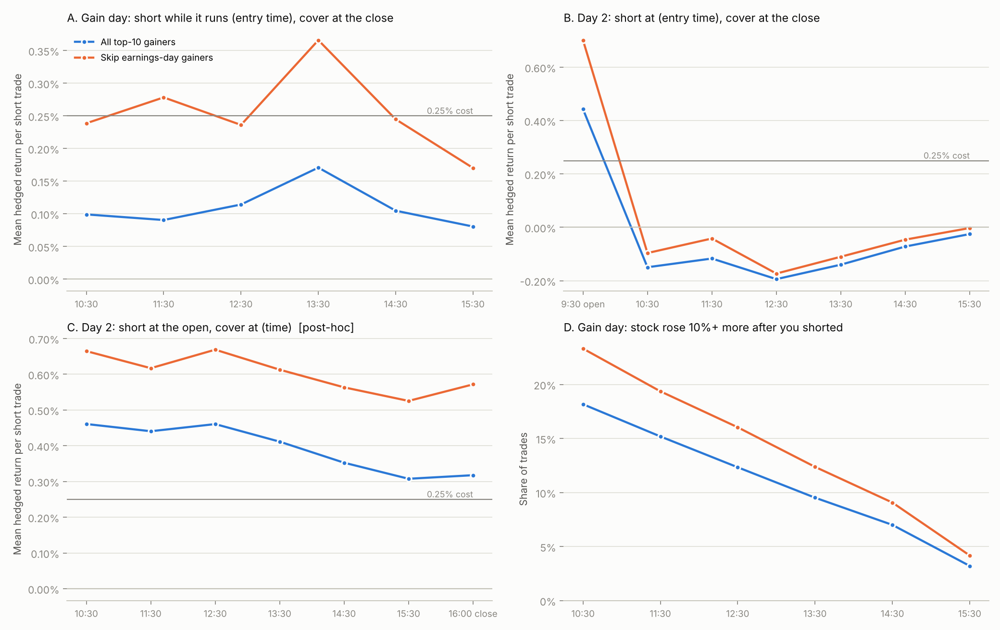

# Doing it inside one day: intraday addendum

Pre-registered in [`PREREGISTRATION_INTRADAY.md`](PREREGISTRATION_INTRADAY.md) (commit `dc95305`) before
any intraday return was computed. Results are in [`results/intraday_*.csv`](results/).

## Bottom line

**No, you can't make it work by shorting mid-day or right before the close.** All six pre-registered
cells failed. The pass/fail bar was a positive mean at 0.25% cost, a Bonferroni-adjusted CI above
zero, and a profit in both halves of the window.

| What you'd do (2023-12-29 to 2026-11-25) | Trades | Gross per trade | Winners | Mean per day at 0.25% cost | Verdict |
|---|---|---|---|---|---|
| Gain day: short at 12:30 while it runs, cover at the close | 6,196 | +0.11% | 51% | −0.12% | Doesn't work |
| Gain day: short at 15:30, cover at the close | 6,602 | +0.08% | 51% | −0.15% | Doesn't work |
| Same, skipping earnings-day gainers, 12:30 | 4,436 | +0.24% | 53% | −0.01% | Doesn't work |
| Same, skipping earnings-day gainers, 15:30 | 4,884 | +0.17% | 52% | −0.05% | Doesn't work |
| Day 2: short at 12:30 instead of the open, cover at the close | 6,142 | −0.19% | 50% | −0.37% | Doesn't work |
| Same, skipping earnings-day gainers | 4,525 | −0.17% | 51% | −0.26% | Doesn't work |

* **Shorting a stock while it is still running is close to a coin flip.** From any checkpoint to the
  close, the average gain-day short earned only +0.08% to +0.17% before costs. Between 12% and 18% of
  the 10:30–12:30 entries saw the stock rise another 10% or more that same afternoon. The worst 12:30
  short lost 433%.
* **Entering right before the close does nothing.** The last half-hour averages +0.08% per trade,
  well below any realistic cost.
* **The day-2 edge comes entirely from the open.** Shorting at the official open and covering at the
  close earned +0.44% per trade (+0.70% skipping earnings gainers) in this window, matching the main
  study. Every later entry, from 10:30 to 15:30, lost money.
* **Post-hoc: the fade is done by about 10:30.** This was spotted after seeing Test II, so it is a
  lead, not a verdict. A short at the first print of day 2 covered at 10:30 earned:
  * all gainers: +0.46% per trade, Sharpe 1.07 at 0.25% cost;
  * skipping earnings gainers: +0.66% per trade, Sharpe 1.69, 95% CI of the daily mean +0.11% to
    +0.46%, positive in both halves.

  That is the same edge as holding to the close (+0.32% / +0.57% in this series) with a much smaller
  tail: the 1st-percentile trade was −22% at 10:30 against −36% at the close. Covering early also
  keeps you out of afternoon squeezes and means no position is open overnight.
* **Holding overnight from 15:30 (Test III, descriptive)** to the next day's close earned +0.18%
  (+0.45% skipping earnings gainers). After 0.25% cost and 30%-a-year borrow, that leaves at most
  about +0.08% per trade.
* **The Wealthsimple FX fee decides everything.** At about 3% per round trip from a CAD account, every
  variant here, including the best one, loses 2.4–2.7% of capital per day at 10% per trade.



Files:
* `results/intraday_primary_verdicts.csv`
* `results/intraday_I_gain_day.csv`
* `results/intraday_II_day_two.csv`
* `results/intraday_III_overnight.csv`
* `results/intraday_posthoc_day2_fade_path.csv`
* `results/intraday_summary.json` (coverage audit)


## 1. The fee question (Wealthsimple)

Wealthsimple's public pages were read on 2026-11-27. Three help-centre articles refused automated
access, so details that only they hold are marked as unconfirmed.

| Cost | When it applies | Does a same-day trade avoid it? |
|---|---|---|
| **Currency conversion, 1.5%** | Every filled order in a US-listed stock from a **CAD** account (fee schedule) | **No.** A short and its cover are two orders, so about 3% per round trip, five to seven times the edge measured here. A **USD account** removes it ($10/month; free for Premium and Generation clients). Moving CAD into it costs 1.5% under $10k, 1% for $10k–25k, 0.5% for $25k–100k and 0% above $100k. |
| **Stock borrow fee** | Industry practice: accrues daily on short positions held overnight. Wealthsimple's learn page says it "can spike to 50% or more" a year for hard-to-borrow names | **Normally yes:** a short opened and covered the same day holds no position overnight. Wealthsimple's fee schedule lists no borrow fee and doesn't describe same-day treatment, so confirm with them. |
| **Margin interest** | On debit balances, "calculated daily and charged monthly" | A short sale creates a credit, not a debit, so this normally doesn't apply. |
| **Pass-through fees** | ECN or regulatory fees on US orders "may be passed on" | Small per order. |
| **Ability to short at all** | Requires a non-registered margin account (no TFSA or RRSP) and a locate | Unknown per stock. Wealthsimple publishes no shortable list, and hot small caps are often unborrowable. |

Sources:
[Wealthsimple trade fee schedule](https://www.wealthsimple.com/en-ca/legal/fees/trade),
[What is short selling (Wealthsimple)](https://wealthsimple.com/en-ca/learn/what-is-short-selling),
[Margin trading resources](https://www.wealthsimple.com/en-ca/margin-trading-resources),
[Margin account FAQs](https://www.wealthsimple.com/en-ca/learn/margin-account-faqs),
[USD accounts subscription](https://www.wealthsimple.com/en-ca/magazine/usd-accounts-subscription),
[Questrade: cost of short selling](https://www.questrade.com/learning/investing-basics/cost-of-short-selling).

## 2. Data and method

* **Hourly bars.** Yahoo hourly bars, regular session (09:30, 10:30, …, 15:30 ET), for 2023-12-29 to
  2026-11-25 (730 trading days). Daily bars with split history were pulled at the same moment. The
  universe is every ticker that could have been an intraday top gainer: 4,190 tickers plus SPY
  (`data/intraday_tickers.csv`, `data/intraday_fetch_log.csv`).
* **The ranking uses only what was known at the time.** At 12:30 the candidates are ranked by their
  gain *at 12:30*, not by how the day ended. Using the end-of-day top-gainer list would quietly pick
  stocks already known to have held their gains.
* **Two data hazards found and fixed before any result was read:**
  * **Hourly volume is not split-adjusted, but hourly prices are.** Checked on NVDA's and SMCI's 10:1
    splits: pre-split hourly volume is one tenth of the adjusted daily volume, while prices match to
    the cent. Dollar volume to time T is therefore computed as adjusted price × split factor × raw
    volume.
  * **Missing hourly bars on halted squeeze days.** On ELPW's 2026-01-30 spike, Yahoo has only the
    first hourly bar of a 26M-share day. Forward-filling the last price would have created stale,
    untradeable entry prices. An entry at T therefore requires a real print in the hour before T.
    Days whose last hourly bar disagrees with the official close by more than 10% are counted, not
    dropped, because dropping them would remove exactly the halted squeezes.
* **Coverage gaps.** Stocks listed after 2023-12-29 only have hourly data from 2024-11-28, a Yahoo
  limit. Renamed tickers lose their hourly history before the rename. Both shrink the cross-section,
  mostly in the first half of the window; see the coverage audit in `results/intraday_summary.json`.

## 3. Coverage audit and deviations from the pre-registration

* **Coverage.**
  * Test I candidate ticker-days (high ≥ +10%): 143,962. Of these, 12.5% had no hourly bars (recent
    listings before 2024-11-28, renamed tickers, a few gaps).
  * Among days that would likely have qualified (traded close ≥ $5, ≥ $5M traded), the missing share
    is 7.6% in the first half and 2.8% in the second.
  * Test II used 6,706 day-2 events.
* **Deviation 1: hourly/daily consistency filter.** Added after the first full run produced
  impossible values (a −17,950% trade). For 556 tickers, Yahoo's hourly prices sit on a different
  split basis than the daily prices: KALA's are 30× the daily, TGL's 24×, SMX's 0.006×. A ticker-day
  is used only if every hourly bar lies within the official daily high–low range (±2%). That excluded
  2,323 candidate days. An hourly print cannot legitimately fall outside the daily range, so the
  filter uses no outcome information.
* **Deviation 2: exit price.** Exits use the last hourly print (the 15:30–16:00 bar) rather than the
  official close, so entry and exit come from the same price series. The official close is used only
  when that bar is missing on a consistent day. Test III's next-day open and close also come from the
  hourly series.
* **Added: the day-2 fade path.** Post-hoc, as labeled above.
* **Measured difference between the two price series.** Day-2 open-to-close from the official
  open/close averaged about 0.12% per trade more than first-print-to-last-print in the hourly series.
  Auction fills (market-on-open, market-on-close) matter at this scale.

## 4. Limitations

* Hourly bars are coarse. "12:30" means the last trade in the 11:30–12:30 bar, and a real order would
  get a slightly different fill. Mid-day entries cross the spread on fast-moving names, so 0.25% is
  optimistic for them.
* Halts (LULD) and the short-sale restriction are not modeled. Halted squeezes make the left tail
  worse than shown for any entry after the open.
* Three years, one market regime. No separate validation period; the two-halves rule is the only
  stability check.
* Survivor-only universe, as in the main study.
* Wealthsimple borrow availability and same-day fee treatment are unconfirmed, as noted in §1.

## 5. Reproduce

```bash
python short_gainers/src/fetch_intraday.py          # hourly + daily bars (~25 min)
python short_gainers/src/fetch_intraday.py --retry  # tickers listed after 2023-12-29
python short_gainers/src/intraday_analysis.py       # Tests I-III, verdicts, fade path, fig 7
```
