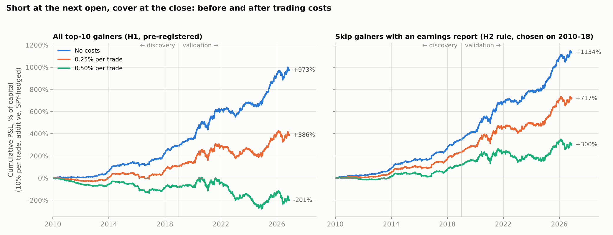
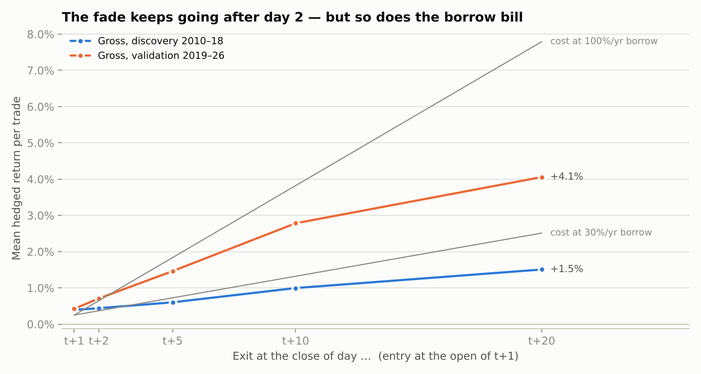
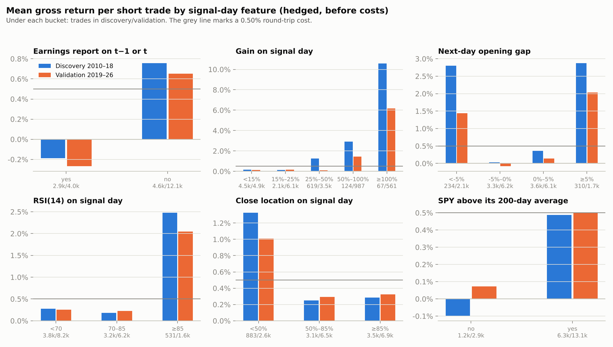
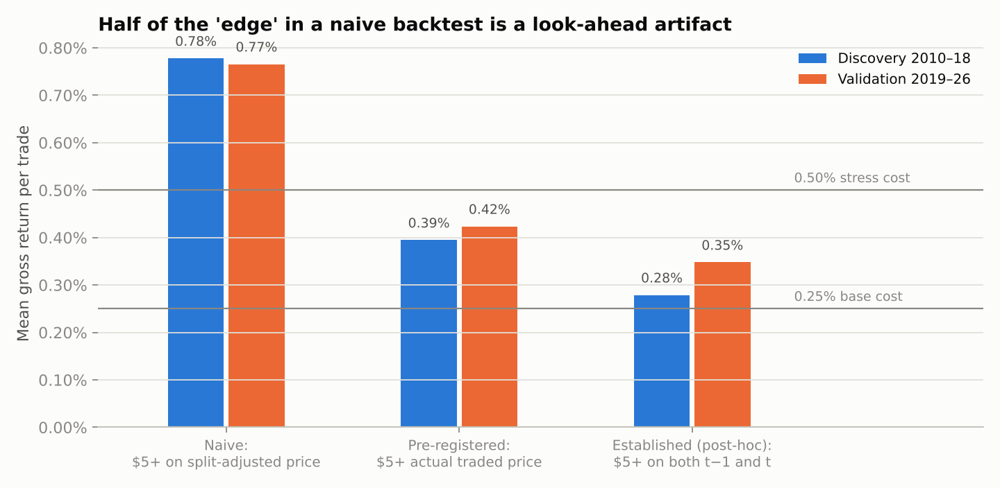
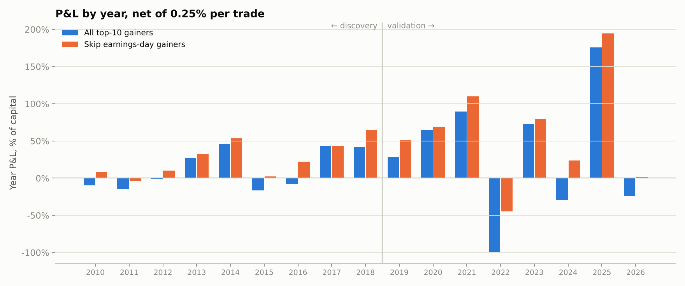
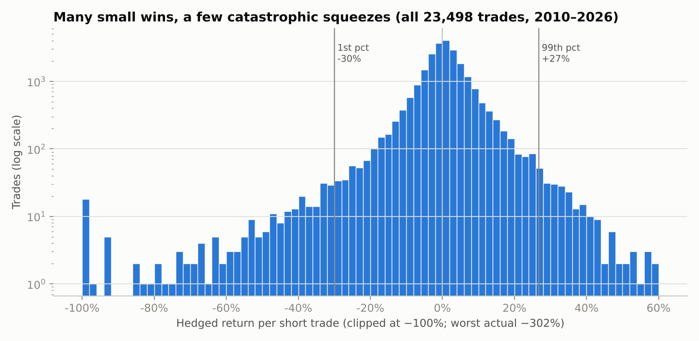

# Shorting the Day's Top Gainers: Report

Data pulled 2026-11-24. The design was fixed in [`PREREGISTRATION.md`](PREREGISTRATION.md) and pushed in
commit `8189286` before any forward return was computed. Every number below comes from a file in
[`results/`](results/). Percentages are per short trade unless labeled per day.

## Bottom line

| Test | What it is | Verdict (pre-registered rule: 2019–26 mean daily P&L > 0 with 95% CI above 0, at 0.50% cost per trade) |
|---|---|---|
| **H1** | Short all top-10 gainers (≥ +10%, ≥ $5 traded price, ≥ $10M traded) at the next open, cover at that close, SPY-hedged | **FAIL**: −0.062% per day, CI −0.225% to +0.109% |
| **H2** | The rule a fixed search picked on 2010–18 data only: *skip gainers with an earnings report on the gain day or the day before* | **FAIL at 0.50%**: +0.092% per day, CI −0.056% to +0.248%. **Passes at the 0.25% base cost**: +0.244% per day, CI +0.096% to +0.403%, Sharpe 1.05 |

1. **The fade is real.** Shorting yesterday's top gainers at the next open and covering at the close
   earned +0.39% (2010–18) and +0.42% (2019–26) per trade before costs, with Newey–West t of 4.7 and
   4.1. But a round-trip cost of about 0.4% erases it, so the unconditional strategy is not a
   tradeable edge.
2. **Earnings decide it.** 29% of top gainers moved on an earnings report. Those don't fade
   (−0.19% / −0.27% per trade; post-earnings drift). The rest fade +0.76% / +0.65% per trade. The
   rule was chosen on 2010–18 data and its edge barely shrank out of sample. On 2019–26 it stays
   statistically positive for all-in costs up to **0.40% per trade**, and it made money in 15 of 17
   calendar years at 0.25% cost.
3. **Which gainers fade is stable.** Feature effects measured in 2010–18 predict 2019–26 effects with
   correlation 0.91 across 44 buckets. Bigger gainers fade more, as do day-2 gap-ups ≥ 5%, RSI ≥ 85,
   weak closes, and names already up 20%+ over the prior month. The fade disappears when the S&P 500
   is below its 200-day average.
4. **Two narrow setups look strong but are post-hoc.** Both apply to non-earnings gainers that were
   already ≥ $5 the day before. A day-2 open ≥ 5% above the prior close earned +2.46% per trade on
   2019–26 (64% winners). RSI(14) ≥ 85 earned +2.15%. Both stay positive at 0.50% cost. They were
   singled out after seeing 2019–26 data, so they are leads for paper trading, not findings.
5. **Traps.** Screening on split-adjusted prices (what most price databases give you) roughly doubles
   the apparent edge, because it lets in sub-$1 pump-and-dumps that later reverse-split. The return
   distribution has a brutal left tail: the worst trade lost 302% of the position. Stop-losses cap
   that tail but cost more expected return than they save.
6. **A second database agrees.** An independent SQL replication on the shibui database matches the
   Yahoo-based pipeline month by month (correlation 0.95 / 0.97).



## 1. Design

The full specification is in [`PREREGISTRATION.md`](PREREGISTRATION.md):

* **Event:** each day, the 10 biggest close-to-close gainers of at least +10%, with traded close ≥ $5,
  ≥ $10M dollar volume that day, and ≥ 60 days of history.
* **Trade:** short at the next open, cover at that day's close, with an equal-dollar long SPY hedge.
* **Portfolio:** fixed 10% of capital per trade.
* **Costs:** 0, 0.10, 0.25 (base), 0.50 (verdict) and 1.00% per round trip.
* **Sample split:** discovery = signal days 2010-01-04 to 2018-12-31; validation = 2019-01-02 to
  2026-11-20.
* **Inference:** 95% moving-block bootstrap CI of the mean daily return (21-day blocks, 10,000 draws),
  with Newey–West t (5 lags) alongside.

The H2 search was forward-stepwise and run on discovery data only. Step 1 tried 80 single-condition
filters across 17 pre-specified features. Step 2 tried adding a second condition, which was kept only
if it raised discovery Sharpe by ≥ 0.20. Every filter needed ≥ 300 discovery events. The selected
rule was then tested once on validation.

## 2. Data

| Item | Count | File |
|---|---|---|
| Nasdaq screener securities (2026-11-24) | 7,343 | `data/universe_audit.csv` |
| Kept: common/ordinary shares, ADRs; SPACs tagged | 5,540 (excluded: 515 preferred, 410 warrants, 340 funds, 275 units, 158 debt, 105 rights) | `data/universe.csv` |
| Yahoo price histories retrieved | 5,538 ok, 5 empty | `data/price_fetch_log.csv` |
| Daily price rows (2008-06 to 2026-11) | 15,530,469 rows, 5,534 tickers | cached, git-ignored |
| Candidate pool (gain ≥ 10%, DV ≥ $2M, price ≥ $1 traded or ≥ $5 adjusted) | 106,606 | `data/events.parquet` |
| Excluded from the main ≥ $5 universe | 1,885 short history, 170 split within ±2 days, 10 probable data errors, 1 multi-day gap | `data/event_exclusions.csv` |
| **Top-10 events** | **23,537 on 3,959 days**; 23,498 tradeable next day (39 not) | |
| Earnings announcements (Nasdaq calendar) | 218,023 rows; 98.4% of event dates covered | `data/earnings_dates.csv.gz` |

**Traded-price reconstruction.** Yahoo, like most vendors, back-adjusts prices for later splits. The
price that actually traded is rebuilt as `adjusted × product of split ratios after that date`. This was
checked against AMC on 2021-01-27: it traded at $19.90, the adjusted series shows $199.00, and the
reconstruction gives $19.90. Without this step, 9,168 of the 56,753 gainers that pass a naive $5+
screen (16%) would be misclassified, because they actually traded under $5. They make up 26% of a
naive top-10 list.

**Survivorship.** Both price sources and the earnings calendar cover only companies listed today. Of
today's names, 2,318 have data in 2010, against 5,534 in 2026 (`data/coverage_by_year.csv`). The
missing names are mostly spiked-then-collapsed small caps, which would likely have *helped* the
short, and takeover targets, which are roughly neutral the next day. So the expected bias runs against
the strategy, most of all for multi-day holds. It cannot be measured.

**Event mix.** Events per active day averaged 3.75 in discovery and 8.14 in validation. The events
span 3,495 distinct tickers. Health care is 27.8% of events versus 18% of the universe, which is below
the 40% / 2× concentration flag. SPACs are 0.06% of events, so F17 is inert. 10% of events had a prior
close under $5, meaning penny stocks jumping above $5.

## 3. H1: the pre-registered strategy

Source: `results/h1_primary.csv`. Daily values are portfolio P&L in % of capital.

| Period | Cost/trade | Trades | Gross/trade | Median | Hit | Mean/day | 95% CI (day) | Sharpe | NW t | Max DD |
|---|---|---|---|---|---|---|---|---|---|---|
| 2010–18 | 0 | 7,454 | +0.39% | +0.35% | 54.3% | +0.130% | +0.072% to +0.189% | 1.55 | 4.66 | −34% |
| 2010–18 | 0.25% | | | | | +0.048% | −0.010% to +0.106% | 0.57 | 1.71 | −46% |
| 2010–18 | 0.50% | | | | | −0.035% | −0.092% to +0.023% | −0.41 | −1.24 | −77% |
| 2019–26 | 0 | 16,044 | +0.42% | +0.57% | 54.2% | +0.342% | +0.179% to +0.517% | 1.40 | 4.08 | −62% |
| 2019–26 | 0.25% | | | | | +0.140% | −0.023% to +0.313% | 0.57 | 1.67 | −81% |
| **2019–26** | **0.50%** | | | | | **−0.062%** | **−0.225% to +0.109%** | −0.25 | −0.74 | −98% |

The 1st and 99th percentiles per trade were −15.7% / +18.0% (2010–18) and −34.0% / +29.4% (2019–26).
The worst trades were −93% and −302%, and the worst days −8.9% and −30.3% of capital. **Verdict: FAIL.**
The validation CI clears zero only for costs up to 0.20% per trade (`results/break_even_costs_validation.csv`).

## 4. H2: the rule search

Source: `results/h2_rule_search_discovery.csv`, `results/h2_selected_rule.csv`.

* **Step 1.** The best of 80 filters was *no earnings report dated t−1 or t*, with discovery Sharpe
  1.33 at base cost (unconditional: 0.57). The next best were gain ≥ 25% (1.25) and traded price
  < $10 (1.23).
* **Step 2.** The best addition was day-t dollar volume ≥ $30M, at Sharpe 1.53. That is +0.197, below
  the +0.20 bar, so the rule stays at one condition.

| Period | Cost/trade | Trades | Gross/trade | Median | Hit | Mean/day | 95% CI (day) | Sharpe | NW t | Max DD |
|---|---|---|---|---|---|---|---|---|---|---|
| 2010–18 | 0.25% | 4,601 | +0.76% | +0.72% | 57.8% | +0.103% | +0.055% to +0.153% | 1.33 | 4.20 | −27% |
| 2010–18 | 0.50% | | | | | +0.052% | +0.005% to +0.101% | 0.68 | 2.14 | −38% |
| 2019–26 | 0.25% | 12,065 | +0.65% | +0.85% | 55.7% | +0.244% | **+0.096% to +0.403%** | **1.05** | 3.09 | −62% |
| **2019–26** | **0.50%** | | | | | **+0.092%** | **−0.056% to +0.248%** | 0.39 | 1.17 | −81% |

**Verdict: FAIL at the pre-registered 0.50% bar.** The rule nonetheless replicated:

* The edge per trade fell only from +0.76% to +0.65%.
* At the 0.25% base cost the validation CI excludes zero.
* The CI clears zero for costs up to 0.40% per trade.
* It made money in 15 of 17 years at 0.25% cost, against 9 of 17 for H1 (`results/F_per_year.csv`).

Whether it is tradeable for a given trader turns on all-in execution plus locate cost, which this data
cannot observe.

## 5. Exploratory battery

These results are descriptive and are never promoted to the headline.

**A. Entry × exit** (`results/A_entry_exit_grid.csv`, figure 3).

* Overnight, gainers keep rising slightly in 2010–18 (short return −0.19%) and give back a little in
  2019–26 (+0.11%). So the day-2 *intraday* fade is the core of the effect, and the next-day open is
  the better entry.
* Holding longer captures more. Entering at the next open and exiting at the t+20 close earned
  +1.51% / +4.06% per trade gross (hit rate 54% / 61%).
* Borrow decides the longer holds. At 30% a year the t+20 hold nets −1.00% / +1.54%, and at 100% a
  year −6.28% / −3.73%. No borrow-fee history was available, so this stays unresolved.



**B. Feature profiles** (`results/B_feature_profiles.csv`, figure 2).

* **Earnings:** yes −0.19% / −0.27%; no +0.76% / +0.65%.
* **Gain size:** 10–15% earned +0.18% / +0.12%; ≥ 100% earned +10.6% / +6.2%. Only 67 / 561 trades
  fell in the ≥ 100% bucket.
* **Day-2 gap:** gap-ups ≥ 5% earned +2.87% / +2.04% and gap-downs ≥ 5% +2.81% / +1.44%. The
  in-between gaps earned about zero.
* **Momentum and close:** RSI ≥ 85 earned +2.48% / +2.05%, and a close in the bottom half of the day's
  range +1.33% / +1.01%.
* **Market trend:** with SPY above its 200-day average +0.49% / +0.50%; below it −0.10% / +0.07%.

Across the 44 buckets with ≥ 100 trades in both periods, the discovery excess returns predict the
validation excess returns with Pearson 0.91, Spearman 0.79 and sign agreement 86%
(`results/B2_feature_replication.csv`).



**C. Signal variants** (`results/C_signal_variants.csv`). Raising the gain floor to 20% or 30% raises
the per-trade edge to +1.41% / +0.75% and +2.98% / +1.33%. It also concentrates the book, so the
equal-weight version had worst days of −93% to −106%. Top-5, top-10, top-20 and all qualifying names
behave alike at the 10% floor.

**D. Universe variants** (`results/D_universe_variants.csv`). Gross per trade, 2010–18 / 2019–26:

* **Naive split-adjusted $5 screen:** +0.78% / +0.77%, roughly **double** the correct figure.
* **Pre-registered traded-price screen:** +0.39% / +0.42%.
* **Prior close also ≥ $5:** +0.28% / +0.35%.
* **$1–$5 names:** +1.36% / +0.20%, with medians of +2.06% / +1.60%. The worst 2019–26 day was −132%
  of capital, and borrow is usually unavailable.

IWM hedging, excluding SPACs and excluding health care change little.



**E. Stops** (`results/E_stop_overlay.csv`). A buy-stop at +10%, +20% or +30% above entry (filled at the
level plus 1%) cut discovery / validation Sharpe at 0.25% cost from 0.57 / 0.57 to −0.44 / −1.09,
0.28 / −0.01 and 0.40 / 0.29. The +30% stop halved the worst 2019–26 day, from −30.3% to −15.2%.
Halts can fill far worse than the modeled slippage, so the stop results are optimistic.

**F. Per year** (`results/F_per_year.csv`, figure 4). H1 lost money in 8 of 17 years. 2022 alone cost
−100% of capital at 10% slots. H2 lost in 2 of 17 (2011 −4%, 2022 −45%).



**G. Second database** (`results/G_shibui_replication.csv`). shibui has no split history, so the
replication uses the naive screen on both sides:

| Period | Trades (shibui / Yahoo) | Gross/trade (shibui / Yahoo) | Monthly P&L correlation |
|---|---|---|---|
| 2010–18 | 8,303 / 8,562 | +0.74% / +0.78% | 0.95 |
| 2019–26 | 17,379 / 17,502 | +0.72% / +0.77% | 0.97 |

Both sources show the same disaster months, such as May 2026, which confirms those are real squeezes
and not one vendor's bad prints. The SQL is in Appendix G.



## 6. Post-hoc analyses (done after the validation results were seen)

* **H2 diagnostics** (`results/h2_diagnostic_all_filters_validation.csv`,
  `h2_diagnostic_step2_validation.csv`). Across the 73 eligible single filters, discovery Sharpe ranks
  predict validation Sharpe ranks with Spearman 0.73 (0.63 for step-2 combinations). The top 5 by
  discovery Sharpe have a median validation Sharpe of 0.95, against 0.31 for all filters.
* **Candidates for a forward test** (`results/P_posthoc_candidates.csv`). All rows are non-earnings
  gainers with a prior close ≥ $5. Validation CIs are per day at 0.50% cost.

| Setup | Period | Trades | Gross/trade | Median | Hit | Sharpe @0.25% | Sharpe @0.50% | Validation CI @0.50% |
|---|---|---|---|---|---|---|---|---|
| Core rule | 2010–18 | 4,260 | +0.61% | +0.66% | 57% | 1.12 | 0.34 | |
| Core rule | 2019–26 | 10,286 | +0.55% | +0.70% | 55% | 0.85 | 0.14 | −0.10% to +0.15% |
| + day-2 open gaps up ≥ 5% | 2010–18 | 231 | +2.77% | +3.28% | 68% | 0.82 | 0.74 | |
| + day-2 open gaps up ≥ 5% | 2019–26 | 1,245 | +2.46% | +3.59% | 64% | 1.39 | 1.23 | +0.06% to +0.19% |
| + RSI(14) ≥ 85 | 2010–18 | 327 | +2.99% | +1.69% | 63% | 1.27 | 1.16 | |
| + RSI(14) ≥ 85 | 2019–26 | 1,001 | +2.15% | +1.73% | 58% | 1.00 | 0.87 | +0.03% to +0.14% |

The gap rule needs an entry at or just after the open once the gap is known. Fills a few minutes in
can be materially worse than the official opening print.

## 7. Limitations

* **Survivorship.** See §2. Its size cannot be measured; it is most likely conservative for the short.
* **Borrow.** Locate availability and fees for hot small caps are the binding real-world constraint, and
  no free history exists. Intraday holds avoid overnight fees but not locate fees.
* **Execution at the open.** Results use the official daily open and close, as auction fills. A market
  order at 9:30 in a stock that ran yesterday can pay a wide spread.
* **Not modeled.** The short-sale restriction (Rule 201) and LULD halts are not simulated. Stops are
  optimistic for the same reason.
* **Earnings tag.** The historical calendar lacks before/after-market timing, so a two-day window
  (t−1 or t) is used. The calendar is also survivor-only.
* **Sector.** Classification is current, not point-in-time.
* **Sizing.** Fixed 10% slots make drawdowns large. P&L is additive and scales linearly with slot size.
* **Dependence.** Cross-event dependence is handled by the calendar-time portfolio and the block
  bootstrap. Per-event t-statistics are not used for any verdict.
* **Multiple testing.** 597 result cells were computed, all reported (`results/ledger.csv`). Each
  verdict rests on one pre-specified cell. The post-hoc candidates carry selection bias by
  construction.

## 8. Deviations from the pre-registration

1. The candidate pool also keeps rows that only a naive split-adjusted $5 screen would admit. This was
   needed to measure that screen's bias and to match the shibui replication. The primary event set is
   unchanged.
2. Analysis code was debugged on preliminary runs that produced verdicts before all data were in. One
   run used a partial universe (about 45% of tickers). Another used the full universe before the
   earnings calendar had finished downloading. Both gave H1 = FAIL. H2 picked different rules in those
   runs: gain ≥ 25%, then gain ≥ 25% AND entry gap < 5%. The final run uses the complete pre-registered
   feature set, and no definition, threshold or procedure was changed after any preliminary result.
3. Added, clearly labeled analyses:
   * the prior close ≥ $5 ("established") variants;
   * the H2 diagnostics;
   * the post-hoc candidate table, drafted after seeing preliminary validation results;
   * the feature-replication correlation;
   * the validation cost grid;
   * the per-year results for the H2 rule.
4. The event panel is stored as float32 (about 7 significant digits); this is immaterial.

## 9. Reproduce

```bash
pip install pandas numpy scipy statsmodels matplotlib pyarrow yfinance requests
python short_gainers/src/build_universe.py    # Nasdaq screener -> universe + audit
python short_gainers/src/fetch_prices.py      # Yahoo OHLCV + splits (~15 min, cached)
python short_gainers/src/fetch_earnings.py    # Nasdaq earnings calendar (~40 min, cached)
python short_gainers/src/build_events.py      # event panel, features, forward returns
python short_gainers/src/analyze.py           # H1, H2, battery A-F, post-hoc, ledger
python short_gainers/src/replicate_shibui.py  # comparison with data/shibui/*.json (Appendix G)
python short_gainers/src/make_figs.py         # figs/*.png
```

### Appendix G — shibui replication query (validation half; discovery identical with the 2010–2018 window)

```sql
WITH cal AS (SELECT sq.date AS d, LAG(sq.date) OVER (ORDER BY sq.date) AS prev_d,
                    LEAD(sq.date) OVER (ORDER BY sq.date) AS next_d, sq.open AS spy_o, sq.close AS spy_c
             FROM shibui.stock_quotes sq WHERE sq.ticker = 'SPY' AND sq.date >= DATE '2018-06-01'),
px AS (SELECT sq.symbol, sq.date, sq.close, sq.volume,
         LAG(sq.close) OVER w AS prev_close, LAG(sq.date) OVER w AS prev_dt,
         LEAD(sq.open) OVER w AS open_n1, LEAD(sq.close) OVER w AS close_n1,
         LEAD(sq.date) OVER w AS date_n1, LEAD(sq.volume) OVER w AS vol_n1, ROW_NUMBER() OVER w AS rn,
         AVG(sq.volume) OVER (PARTITION BY sq.symbol ORDER BY sq.date ROWS BETWEEN 20 PRECEDING AND 1 PRECEDING) AS vol20
       FROM shibui.stock_quotes sq INNER JOIN shibui.general_info g ON g.symbol = sq.symbol
       WHERE sq.date >= DATE '2018-06-01' AND g.type IN ('Common Stock', 'ADR', 'REIT')
       WINDOW w AS (PARTITION BY sq.symbol ORDER BY sq.date)),
ev AS (SELECT p.symbol, p.date, p.open_n1, p.close_n1, p.date_n1, p.vol_n1,
         p.close / p.prev_close - 1 AS gain, p.close * p.volume AS dollar_vol
       FROM px p INNER JOIN cal c ON c.d = p.date
       WHERE p.date >= DATE '2019-01-02' AND p.prev_dt = c.prev_d AND p.rn > 60 AND p.prev_close > 0
         AND p.close >= 5 AND p.close * p.volume >= 10000000 AND p.close / p.prev_close - 1 >= 0.10
         AND NOT (p.close / p.prev_close - 1 >= 1.0 AND (p.vol20 IS NULL OR p.volume < 1.5 * p.vol20))),
ranked AS (SELECT e.*, ROW_NUMBER() OVER (PARTITION BY e.date ORDER BY e.gain DESC, e.dollar_vol DESC) AS rk FROM ev e),
trades AS (SELECT r.date, (1 - r.close_n1 / r.open_n1) + (c2.spy_c / c2.spy_o - 1) AS s_h
           FROM ranked r INNER JOIN cal c ON c.d = r.date INNER JOIN cal c2 ON c2.d = r.date_n1
           WHERE r.rk <= 10 AND r.date_n1 = c.next_d AND r.open_n1 > 0 AND r.vol_n1 > 0)
SELECT strftime(date_trunc('month', t.date), '%Y-%m') AS ym, COUNT(*) AS n_events,
       ROUND(SUM(0.1 * (t.s_h - 0.0025)), 6) AS month_pnl_base, ROUND(AVG(t.s_h), 6) AS mean_event_gross
FROM trades t GROUP BY 1 ORDER BY 1 LIMIT 200
```
